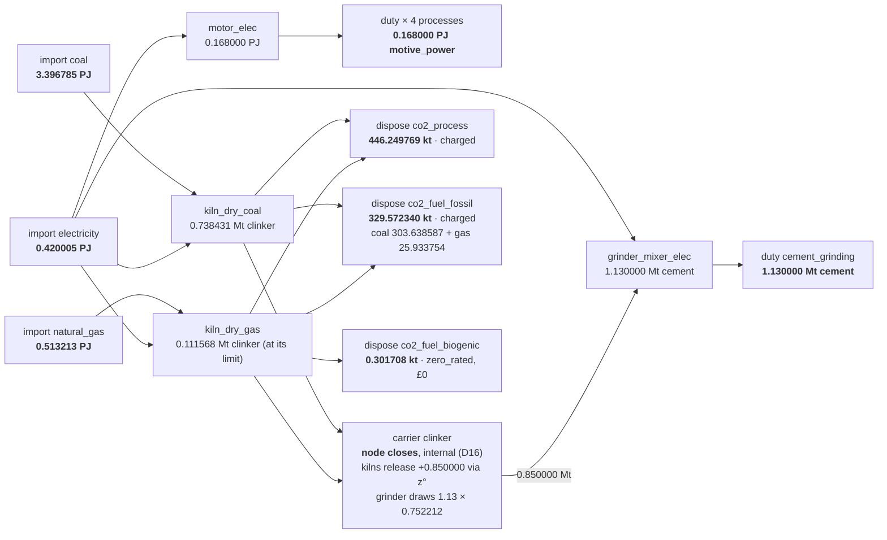
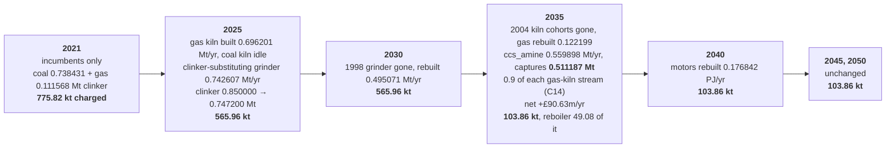
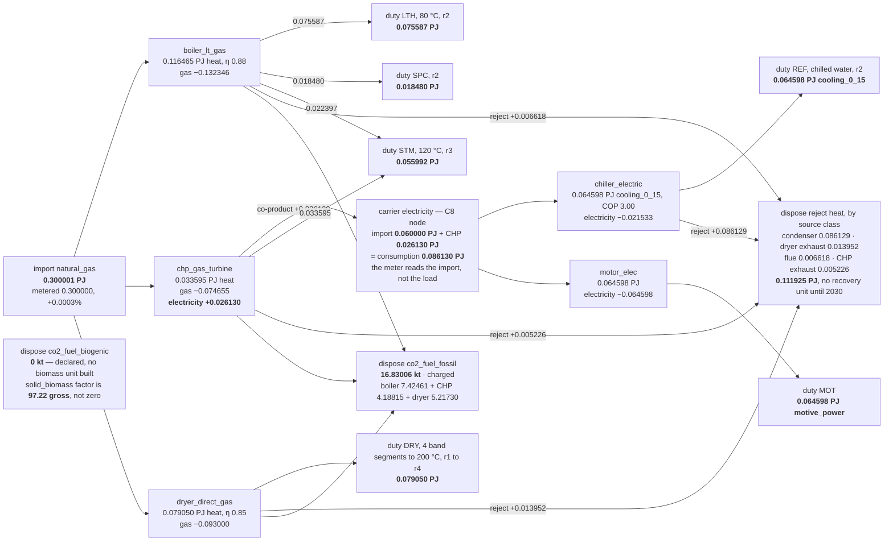
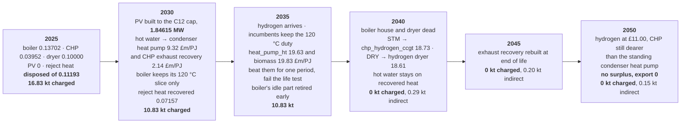

# 19 — The worked examples as diagrams

The two worked examples —
[cement](../specs/2026-08-28-carb3-site-energy-system-worked-example-cement.md) and
[food and drink](../specs/2026-08-28-carb3-site-energy-system-worked-example-food-drink.md) —
carry every number in prose and tables. This note carries the same numbers as pictures: which
data table holds what, what value it holds at each premise, and where that value goes.

**Nothing here is new.** Every figure is lifted from the two worked examples and every one of
them is illustrative, not a citation. Where the two disagree with this note, the worked examples
win.

**This file is hand-written and is not generator output.** The generated diagrams live in
[`docs/specs/diagrams/`](../specs/diagrams/) and
[`docs/specs/archive/diagrams/`](../specs/archive/diagrams/) and are built by
`examples/build_spec_flow_diagram.py`; those must never be hand-edited. This one has no
generator and no `--check`, so its numbers can go stale — the worked examples are the source.

Section references without a document name are to the
[implementation specification](../specs/2026-08-28-carb3-site-energy-system-implementation.md).
Labels carry their meaning in brackets on first use, per the house rule.

---

## 1. The shape both examples share

The same thirteen sections, the same nine algorithms, the same entities. Only the values differ.

```mermaid
flowchart LR
  subgraph PREMISE["What the premise supplies"]
    direction TB
    PR["premise_record §3.1"]
    PE["premise_energy §3.1.1"]
    PT["premise_throughput §3.1.2"]
    PC["premise_connection §3.1.3"]
    PD["premise_process_detail §3.10"]
    PU["premise_process_unit §3.10.2<br/>units and install years"]
    PM["premise_measured_emissions §3.11"]
    PO["premise_operating_profile §3.12"]
  end

  subgraph REF["Reference data, shared across all premises"]
    direction TB
    RC["carrier §3.4"]
    RU["unit §3.5"]
    RE["unit_eligibility §3.5.1"]
    RH["unit_abatement_host §3.5.3"]
    RK["unit_carrier_coefficient §3.6"]
    RD["process_duty §3.9"]
    RS["activity_process_energy_share §3.3.1"]
    RA["activity_default_unit §3.16"]
    RL["process_load_shape §3.13"]
  end

  subgraph SCEN["What the scenario supplies"]
    direction TB
    SI["infrastructure_scenario §3.7"]
    SP["scenario_parameters §3.8"]
  end

  A1["A1 ingest and validate"]
  A2["A2 duties and candidate units"]
  A3["A3 allocate energy onto carriers"]
  A4["A4 back-solve capacity, mix, vintage"]
  A5["A5 apply the scenario"]
  A6["A6 build the problem"]
  A7["A7 solve"]
  A8["A8 output rows and evidence tiers"]
  A9["A9 roll up to GB"]

  PREMISE --> A1 --> A2 --> A3 --> A4 --> A5 --> A6 --> A7 --> A8 --> A9
  REF --> A2
  REF --> A4
  REF --> A6
  SCEN --> A5
```

The four evidence tiers that travel with every output row — `process_evidence_tier`,
`mix_evidence_tier`, `year_evidence_tier`, `area_evidence_tier` — are set by `A1`–`A4` and
never averaged into one score. The two examples land on **different tiers for the same field**,
which is §4 of this note.

---

## 2. Cement: the tables and the values in them

**Premise `mvp-cement`, `Cement Works`, England, base year 2024.** The parity case, on the
`carb3` slice's synthetic premise so every figure checks against a run: a mass duty, a kiln
split into two units by fuel under `D13` (one primary carrier per unit), clinker internal
under `D16` (internal products are carriers, not duties), and a capture train arriving in 2035.

```mermaid
flowchart TB
  subgraph PREM["Premise-supplied: mvp-cement, Cement Works, base year 2024"]
    direction TB
    PR["<b>premise_record</b> §3.1<br/>floorspace 46,000 m²<br/>construction_year 1957 · cluster humber<br/>no available_area"]
    PE["<b>premise_energy</b> §3.1.1, 6 rows, all 2024, modelled<br/>coal 3.407053 · gas 0.502947 · elec 0.420005<br/>light_fuel_oil, solid_biomass, waste_derived_fuel 0 not_consumed<br/><b>total 4.330005 PJ/yr</b>, coverage complete"]
    PT["<b>premise_throughput</b> §3.1.2, mass denominator<br/>clinker 0.850000 Mt/yr (evidence)<br/>cement 1.130000 Mt/yr (the duty)"]
    PC["<b>premise_connection</b> §3.1.3, 3 rows<br/>C-01 electricity 25 MW imp / 0 exp<br/>C-02 natural_gas 20 MW imp<br/>C-03 co2_captured, export unbounded (mass)"]
    PD["<b>premise_process_detail</b> §3.10, 9 rows<br/>kiln_pyroprocessing 2004–, known_capacity 0.95 Mt/yr, known_activity 0.85<br/>four motive-power known_activity rows, 0.168000 PJ/yr in all<br/>process_evidence_tier = site_known"]
    PU["<b>premise_process_unit</b> §3.10.2, 11 rows<br/>kiln: kiln_dry_coal 0.871369 · kiln_dry_gas 0.128631, both 2004<br/>grinder_mixer_elec 1998 · motor_elec 2016"]
    PM["<b>premise_measured_emissions</b> §3.11<br/>no rows ⇒ §7.6 skipped"]
  end

  subgraph REF["Reference data this premise reaches"]
    direction TB
    RC["<b>carrier</b> §3.4, 11 carry a flow<br/>coal, natural_gas (biogenic 0.0115), electricity (indirect)<br/>motive_power, heat_lt60 · clinker (internal), cement, co2_captured<br/><b>co2_process, co2_fuel_fossil charged</b> · co2_fuel_biogenic zero_rated"]
    RU["<b>unit</b> §3.5, 6 units in the model<br/>kiln_dry_coal, kiln_dry_gas 114.7832 £m/(Mt/yr), L 30, α 0.913<br/>ccs_amine 354.5981 · grinders 28.3319 · motor 2.8679, L 20"]
    RH["<b>unit_abatement_host</b> §3.5.3<br/>ccs_amine on 4 dry kilns, 2 in the model"]
    RK["<b>unit_input_output</b> §3.6<br/>kiln: clinker +1, fuel −4.6, co2_process +525 kt/Mt<br/>derived fossil: coal 411.194, gas 232.447752<br/>ccs_amine: <b>capture rate −0.9</b> on each CO₂ carrier<br/>reboiler gas −1.9 ⇒ +96.011028 fossil derived"]
    RE["<b>admission screen</b> §5.7 check 1<br/>12 of 29 eligible units dropped<br/>kiln_dry_wdf: waste_derived_fuel unpriced<br/>four other trains: no coefficients"]
  end

  subgraph SCEN["Scenario published_2026, cluster humber"]
    direction TB
    SI["<b>infrastructure_scenario</b> §3.7<br/>co2_transport from 2030 · hydrogen never<br/>ccs_amine earliest_year 2035"]
    SP["<b>scenario_parameters</b> §3.8<br/>gas 7.04 → 10.53 (2025) → 7.63 £m/PJ<br/>carbon £244.47 → £378.09/t · tariff £40/Mt CO₂"]
  end

  DUTY["<b>process_duty</b> §3.9, 5 duties<br/>cement_grinding → cement <b>1.130000 Mt/yr</b><br/>motive_power <b>0.168000 PJ/yr</b> over 4 processes<br/><b>kiln_pyroprocessing has no duty</b> (D16)"]
  CAP["<b>capacity</b> (A4, as the slice reads §3.10)<br/>kiln_dry_coal 0.827801 · kiln_dry_gas 0.122199 Mt/yr<br/>grinder 1.237678 Mt/yr · motor 0.176842 PJ/yr<br/>mix_evidence_tier = site_known (not pinned in the slice)"]
  LP["<b>A6 the LP</b><br/>6 units × 7 periods, 11 carriers<br/>245 variables, 237 constraints<br/>C14: ccs_amine treats its hosts' flue gas<br/>C11, C12 not built"]

  PREM --> DUTY
  REF --> DUTY
  DUTY --> CAP
  SCEN --> LP
  CAP --> LP
```

### 2.1 The base year, 2021, as a balance

C5 (no building in the start year) forbids building at 2021, so this is the incumbents at
2021 prices.

| Term, 2021, annual | £m |
|---|---|
| $Z^{\text{capex}}$: C5 forbids building at 2021 | 0.000000 |
| $Z^{\text{opex}}$: kilns 3.815514, grinder 1.407822, motor 0.012680 | 5.236015 |
| $Z^{\text{fuel}}$: coal 11.073518, gas 3.613021, electricity 13.230147 | 27.916686 |
| $Z^{\text{carbon}}$: **on disposal**, 775.822109 kt × £244.47/t | 189.665231 |
| **Total** (× δ 3.801637 = £847.0729m discounted) | **£222.817932m** |

Direct emissions **775.822109 kt**. No measured emissions are stated, so §7.6 is skipped.
Indirect, reported and not charged: 0.420005 × 58.02 = **24.368670 kt**.

### 2.2 The pathway

**Objective £3,640.0994m** discounted to 2021, 59.8% of it carbon. **446.25 kt of the base
year is calcination**, and no fuel switch touches it: clinker substitution takes it to
392.28 kt and capture to 39.23 kt.

---

## 3. Food and drink — the tables and the values in them

**Premise `P-004417`, `Food Processing Centre`, England, base year 2024.** The mechanism case:
a milk-powder dairy, four graded heat carriers, four devices competing at one duty, and an
existing CHP the meter hides.

```mermaid
flowchart TB
  subgraph PREM["Premise-supplied — P-004417, Food Processing Centre, base year 2024"]
    direction TB
    PR["<b>premise_record</b> §3.1<br/>floorspace 18,400 m²<br/>construction_year absent<br/>construction_year_band 1965-1984 ⇒ read as <b>1965</b><br/>area supplied directly ⇒ area_evidence_tier = <b>measured</b>"]
    PE["<b>premise_energy</b> §3.1.1 — 5 carriers<br/>natural_gas 0.30000 · electricity 0.06000<br/>fuel_oil, coal, solid_biomass 0.00000 not_consumed<br/><b>coverage complete</b><br/><b>total 0.36000 PJ/yr</b> — but the meter nets the CHP"]
    PT["<b>premise_throughput</b> §3.1.2<br/><b>zero rows, and that is correct</b><br/>every process is energy-denominated under D5"]
    PC["<b>premise_connection</b> §3.1.3 — 2 rows<br/>E-01 electricity 4 MW imp / <b>2 MW exp</b> / 11 kV<br/>available_area <b>12,000 m²</b><br/>G-01 natural_gas 18 MW imp"]
    PD["<b>premise_process_detail</b> §3.10 – 6 rows<br/>direct_heating 2019– , known_capacity <b>0.10000 PJ/yr</b>, known_activity 0.07905 PJ/yr<br/>process_evidence_tier = site_known"]
    PU["<b>premise_process_unit</b> §3.10.2 — 3 rows<br/>chp_gas_turbine 2011, dies <b>2035</b><br/>boiler_lt_gas 2016, dies <b>2035</b><br/>dryer_direct_gas 2019, dies <b>2038</b><br/>capacity_share blank ⇒ CHP/boiler split from activity_default_unit"]
    PM["<b>premise_measured_emissions</b> §3.11<br/>2022 17.9 kt · 2023 17.3 kt<br/><b>no base-year row</b> ⇒ emissions_year_unmatched<br/>reported, never a rejection ⇒ §7.6 <b>skipped</b>"]
    PO["<b>premise_operating_profile</b> §3.12<br/>three_shift, 7,200 h/yr, 2 shutdown weeks<br/>peak_electricity 3.4 MW, load factor 0.56<br/>within_shift_peak_factor <b>1.47</b>"]
    PL["<b>process_load_shape</b> §3.13 — 6 rows<br/>boiler batch_cyclic 0.55, peak_to_mean 2.40<br/>refrigeration standing, <b>summer_weighted</b><br/>2 standing rows run when idle"]
  end

  subgraph REF["Reference data this premise reaches"]
    direction TB
    RC["<b>carrier</b> §3.4 — 19 rows, <b>5 gradeable</b><br/>heat_lt60 r1 · heat_60_100 r2<br/>heat_100_150 r3 · heat_150_400 r4<br/>cooling_0_15 r2, cooling family<br/>motive_power intermediate<br/><b>5 reject carriers, one per source class</b>: flue clean, flue solid/liquid,<br/>engine exhaust, dryer exhaust, chiller condenser<br/>co2_fuel_fossil charged · co2_fuel_biogenic zero_rated<br/><b>no co2_process at all</b>"]
    RU["<b>unit</b> §3.5 — 22 rows, fuel in the identity (D13)<br/>boiler_lt_gas 4.5 £m/(PJ/yr), grade_out 4<br/>boiler_lt_biomass <b>7.9</b>, α 0.82 — the D13 payoff<br/>heat_pump_lt_air 16.0, <b>grade_out 2</b><br/>heat_pump_ht 26.0, grade_out 3, grade_in_max 2<br/>chp_gas_turbine 38.0, L 25 · dryer_direct_gas 5.0, grade_out 4<br/>pv_rooftop 0.62 £m/MW, α 0.11, 6,500 m²/MW<br/>3 recovery units at unit.csv costs:<br/>heat_pump_chiller_condenser 21.3479, COP 3.95<br/>recovery_engine_exhaust 12.9808 · economiser 14.4867"]
    RK["<b>unit_carrier_coefficient</b> §3.6<br/>boiler_lt_gas: heat_100_150 +1.00000, gas −1.13636,<br/>co2_fuel_fossil +63.74980 <i>derived</i><br/>chp_gas_turbine: heat +1.00000, gas −2.22220,<br/><b>electricity +0.77780 co-product</b><br/>dryer_direct_gas: <b>reject_dryer_exhaust +0.17650 role=reject</b><br/>chiller_electric: <b>reject_chiller_condenser +1.33330</b><br/>heat_pump_chiller_condenser: condenser −0.74680, COP 3.95<br/>boiler_lt_biomass: biomass −1.12360, η 0.89"]
    RE["<b>unit_eligibility</b> §3.5.1<br/>boiler_lt_coal <b>max_share 0.00</b> — screened at this site<br/>chp_biomass_st min_duty 0.25 &gt; 0.07559 ⇒ <b>screened out</b><br/>hydrogen units earliest_year 2035<br/>heat_pump_ht earliest_year 2030<br/>recovery units pass min_viable_scale: all 3 offered"]
    RA["<b>activity_default_unit</b> §3.16 — <b>the entity this example turns on</b><br/>boiler_steam_hot_water STM: chp_gas_turbine <b>0.60</b><br/>evidence_tier sector_statistic, DUKES Table 7 / CHPQA<br/>boiler_lt_gas 0.40, derived, residual<br/>LTH and SPC: boiler_lt_gas 1.00"]
    RS["<b>activity_process_energy_share</b> §3.3.1<br/>gas → boiler 0.62, direct_heating 0.31, site_services 0.07<br/>elec → motors 0.45, refrigeration 0.25,<br/>site_services 0.20, compressed_air 0.10"]
  end

  subgraph SCEN["Scenario central, cluster mersey"]
    direction TB
    SI["<b>infrastructure_scenario</b> §3.7<br/><b>hydrogen false → true at 2035</b>, no tariff<br/>co2_transport <b>false throughout</b><br/>grid_headroom true throughout"]
    SP["<b>scenario_parameters</b> §3.8, £m per PJ<br/>gas 7.10→8.80 · elec 32.00→23.50<br/>hydrogen <b>19.50→11.00</b> from 2035<br/>biomass 15.00→19.00 · export elec 19.00→13.50<br/>carbon £90→£275/t · elec factor 18.0→3.0 kt/PJ<br/>hydrogen factor <b>0.0</b> — a scenario assumption<br/>biomass factor <b>97.22 gross</b>, biogenic_fraction 1"]
  end

  DUTY["<b>process_duty</b> §3.9 — 9 duties, 7 graded heat, 1 graded cooling<br/>LTH heat_60_100 r2 <b>0.075587 PJ/yr</b><br/>STM heat_100_150 r3 <b>0.055992 PJ/yr</b><br/>DRY 4 band segments r1 to r4 <b>0.079050 PJ/yr</b> in all<br/>SPC heat_60_100 r2 <b>0.018480 PJ/yr</b><br/>REF cooling_0_15 r2 <b>0.064598</b> · MOT motive_power <b>0.064598</b>"]
  CAP["<b>A4 back-solved capacity</b><br/>boiler_lt_gas 0.137018 PJ/yr, serving <b>three duties</b><br/>chp_gas_turbine 0.039524 · dryer 0.100000 known<br/>chiller 0.071776 · motor 0.067998<br/><b>consumption 0.086130 = import 0.060000 + CHP 0.026130</b><br/>mix_evidence_tier = <b>activity_default</b>, the weakest tier"]
  LP["<b>A6 the LP</b><br/>6 periods, 9 duties, 19 carriers, 2 connections<br/>chp_biomass_st screened out, hydrogen units held back to 2035<br/>C10 cascade: <b>36 h-variables</b>, 6 grade pairs × 6 periods<br/>C11 never binds · C12 binds on PV"]

  PREM --> DUTY
  REF --> DUTY
  DUTY --> CAP
  SCEN --> LP
  CAP --> LP
```

### 3.1 The base year, 2025, as a balance

| Term, 2025 undiscounted | £m |
|---|---|
| $Z^{\text{capex}}$ — C5 forbids building at $t_0$ | 0.00000 |
| $Z^{\text{opex}}$ — boiler 0.024663, CHP 0.047429, dryer 0.021000, chiller 0.015791, motor 0.023799 | 0.13268 |
| $Z^{\text{fuel}}$ — gas 2.130007, electricity 1.920000 | 4.05001 |
| $Z^{\text{carbon}}$ — **on disposal**, 16.83006 kt × £90/t | 1.51471 |
| $Z^{\text{infra}}$, $Z^{\text{net}}$, $Z^{\text{exp}}$, $Z^{\text{strand}}$ | 0.00000 |
| **Total** | **£5.69740m** |

Direct emissions **16.83006 kt**, all natural gas, all vented. There is **nothing to reconcile
against** — no base-year measured row — so §7.6 is skipped and said to be skipped on every
output row. Indirect, reported and not charged: 0.060000 × 18.0 = **1.08000 kt**, on the
import, which is 30% below the site's consumption because the CHP supplies the rest.

The §7.7 allocation of the CHP's 4.18815 kt across its two outputs puts its electricity at
**282 gCO₂e/kWh** against a 2025 grid import at 65 gCO₂e/kWh — reported beside the accounted
layer and **never added to it**.

### 3.2 The pathway

**The whole footprint is combustion**, so it goes to zero the moment the fuel does. That is
the structural contrast with cement, and it is a property of the duty set — §3.1.2 has zero
rows here — rather than of the technology.

---

## 4. Where the same field lands on different values

The two examples were chosen so that the branches of the tiered rules are exercised across the
pair. This is that table; where both land on the same branch it says so.

| Field or rule | Cement `mvp-cement` | Food and drink `P-004417` |
|---|---|---|
| `D5` denominator | **mass**: Mt clinker, Mt cement | **energy**: PJ throughout |
| `premise_throughput` §3.1.2 | mandatory, 2 carriers | **zero rows**, and correct |
| `year_evidence_tier` §3.1.1 | `base_year` on every carrier | `base_year` on every carrier: the substitution branch is exercised by neither |
| `carrier_coverage` | complete, three explicit zeros | complete, all five vectors stated |
| `area_evidence_tier` §3.10 | would be **`proxy`** (no `available_area`); C12 not built in the slice | **`measured`**: 12,000 m² surveyed |
| `mix_evidence_tier` §4.1 | tier 1 **`site_known`**: the kiln units' `capacity_share` is stated | tier 3 **`activity_default`**: three units share gas |
| §7.6 reconciliation | **skipped**: no measured emissions | **skipped**, `emissions_year_unmatched` |
| Gradeable carriers §3.4 | `heat_lt60` only, as reject; C10 has nothing to filter | **five**, four heat and one cooling; C10 has 36 `h` variables, all in the heat family |
| `co2_process` | **446.25 kt/yr** at 2021, untouched by fuel switching | **absent**: no mass denominator |
| Infrastructure §3.7 | CO₂ transport from 2030, **hydrogen never** | **hydrogen at 2035**, CO₂ transport never |
| Onsite generation | none in the model; PV gets no variable in the slice | PV **and** an existing CHP, 30% of load |
| Export | captured CO₂ at `C-03`, a tariffed **cost**; electricity refused | **2 MW**, never reached: the site imports in every period |
| C11 connection | not built; mean gas flow 109.0 MW from 2025 on a 20 MW connection | **slack** on the chosen pathway, −3.85 MW on the all-electric counterfactual |
| Capture | `ccs_amine` from 2035, 0.511187 Mt/yr, 0.9 of each stream (C14) | none |
| Direct emissions, start → 2050 | **775.82 (2021) → 103.86 kt** | **16.83 → 0 kt** |
| Base-year annual cost | **£222.817932m** (2021) | **£5.69740m** |

---

## 5. What the diagrams cannot show

- **`ccs_amine` holds two rows on `co2_fuel_fossil`**: a capture rate of −0.9 as
  `emission_input` and its reboiler's derived +96.011028 kt per Mt as `emission`. §3.6's key
  `(unit_id, carrier_id, role)` holds both; the diagram draws one edge.
- **§5.6 defines only the peak factor λ** (`T23`, complete §5), so the method for rebuilding a
  connection peak is open. The food and drink example's connection arithmetic uses mean flow
  over operating hours times the observed within-shift peak factor, and says this
  **understates** the peak; the cement example quotes mean flow only, since its premise states
  no operating profile.
- **The slice implements tier 1 of the vintage ladder only** (`MF-43`), with C4 (incumbent
  ageing) as an equality: a cohort stands whole to its stated last year, and a unit with no
  vintage row carries no incumbent capacity.
